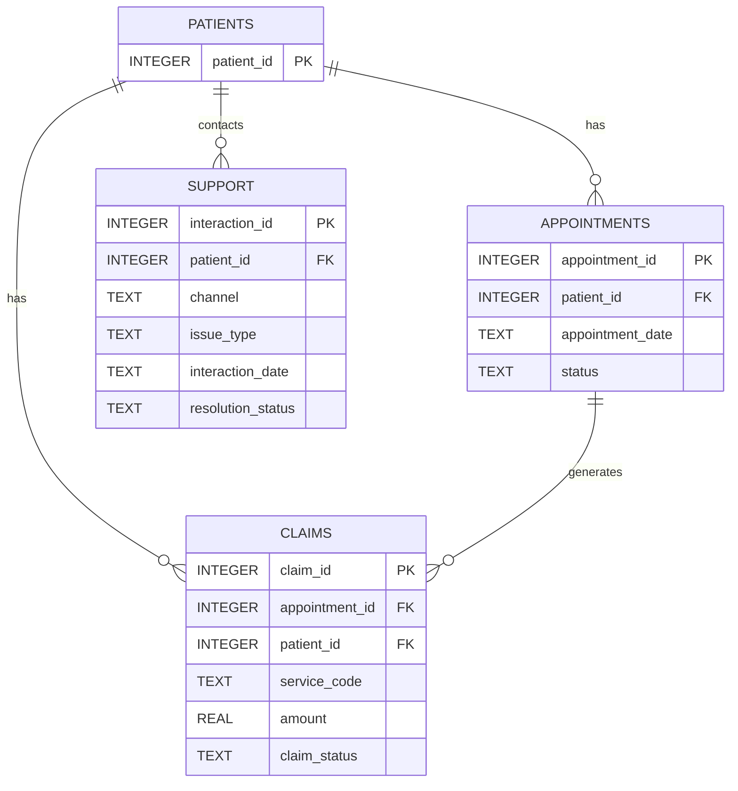

# Hospital Data Platform — Database Design

## 1. Entity Relationship Diagram (ERD)

## 2. Data Dictionary

### patients

| Column | Type | Description |
|---|---|---|
| patient_id | INTEGER, PK | Unique synthetic patient identifier |

### appointments

| Column | Type | Description |
|---|---|---|
| appointment_id | INTEGER, PK | Unique appointment identifier |
| patient_id | INTEGER, FK | References patients.patient_id |
| appointment_date | TEXT | Appointment date in YYYY-MM-DD format |
| status | TEXT | Scheduled, Completed, Cancelled, or No Show |

### claims

| Column | Type | Description |
|---|---|---|
| claim_id | INTEGER, PK | Unique claim identifier |
| appointment_id | INTEGER, FK | References appointments.appointment_id |
| patient_id | INTEGER, FK | References patients.patient_id |
| service_code | TEXT | Synthetic service classification code |
| amount | REAL | Nonnegative claim amount |
| claim_status | TEXT | Submitted, Approved, or Rejected |

### support

| Column | Type | Description |
|---|---|---|
| interaction_id | INTEGER, PK | Unique support interaction identifier |
| patient_id | INTEGER, FK | References patients.patient_id |
| channel | TEXT | Communication channel |
| issue_type | TEXT | Support issue category |
| interaction_date | TEXT | Interaction date in YYYY-MM-DD format |
| resolution_status | TEXT | Escalated, Pending, or Resolved |

## 3. Database Relationships

- One patient can have multiple appointments.
- One patient can have multiple claims.
- One patient can have multiple support interactions.
- One appointment can have multiple claims.
- Every loaded claim must reference an existing appointment.
- Claim-to-appointment patient consistency is enforced by the pipeline validation stage.

## 4. Design Decisions

- SQLite provides a lightweight, reproducible local database.
- Primary keys prevent duplicate identifiers.
- Foreign keys protect referential integrity.
- The claims amount column has a nonnegative CHECK constraint.
- Date values are stored as ISO-formatted text and validated before loading.
- UPSERT supports repeatable loading and updates to existing records.
- Invalid source records are separated into rejected or orphaned CSV files before database loading.

## 5. Limitations

- This is a synthetic assessment dataset, not a production healthcare system.
- SQLite does not provide enterprise-scale concurrent ingestion.
- Dates are stored as text rather than database-native date types.
- Patient-to-appointment consistency for claims is validated in Python rather than through a composite database constraint.
- The patients table contains identifiers only, because no additional patient attributes were required by the synthetic source model.